<div align="center">

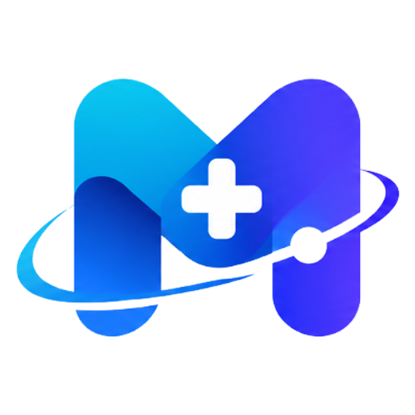

# MedCord · Rural Case Rooms

### A doctor in every village, one tap away.

<sub>Built on</sub>  <sub>**Nexconn**</sub>

Community health workers send a patient case by **voice, text or symptom tap**.<br>
A verified doctor picks it up in a **live private room**. The whole village can help pay for care.

<br>

### 🔗 **[Live demo: med-cord.vercel.app](https://med-cord.vercel.app/welcome)**

<br>

[](https://nexconn.ai)
[](#)
[](#team)


<br>

<p>
<a href="https://med-cord.vercel.app/welcome"><b>Live demo</b></a> ·
<a href="#what-medcord-does">What it does</a> ·
<a href="#built-on-nexconn">Nexconn</a> ·
<a href="#features">Features</a> ·
<a href="#architecture">Architecture</a> ·
<a href="#run-it-locally">Run it</a> ·
<a href="docs/SUBMISSION.md">Submission pack</a>
</p>

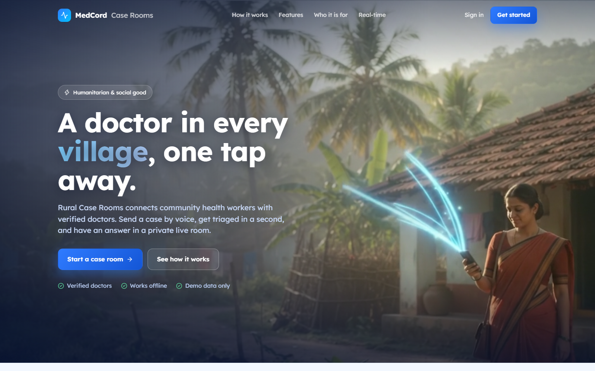

</div>

---

## At a glance

| | |
|---|---|
| **For** | ASHA and community health workers, verified doctors, and the communities around them |
| **Track** | Humanitarian and Social Good |
| **Core promise** | A patient in a remote village reaches a doctor in minutes, in their own language |
| **Nexconn** | Chat SDK for live case rooms, Call SDK for voice and video, Server API for tokens |
| **Also** | Care Fund, Volunteer help, daily check-in, Outbreak Radar, care network map |
| **Languages** | English, Tamil, Hindi, Malayalam, Telugu, Kannada, Bengali |
| **Try it now** | [med-cord.vercel.app](https://med-cord.vercel.app/welcome): tap **Worker**, **Doctor** or **Admin** on the sign-in page |

---

## The problem

In rural India a patient can be hours from the nearest doctor. The **ASHA worker** or **community health worker** in the village is often the only medical help, and she has no fast way to reach a specialist, no way to tell an emergency from a routine case, and no way to help a family that cannot afford surgery.

## What MedCord does

| | |
|---|---|
| **1. Send** | The health worker describes the patient by **voice in her own language**, typing, or tapping symptoms. It works with weak or no signal and sends later. |
| **2. Triage** | The case is structured instantly (SBAR), checked for **red flags** such as chest pain or heavy bleeding, and routed to the right speciality. |
| **3. Answer** | A **verified doctor** accepts the case. They talk in a **live private room on the Nexconn Chat SDK**, with voice-to-text, translation and read-aloud in Indian languages. |
| **4. Learn** | Every doctor answer joins a **verified answer library**, so the next worker with a similar case gets help in seconds. |
| **5. Support** | Serious cases can open a **Care Fund** in the community. Volunteers help with rides and medicine. Peers check in on each other. An **Outbreak Radar** warns when similar cases cluster in one area. |

<div align="center">

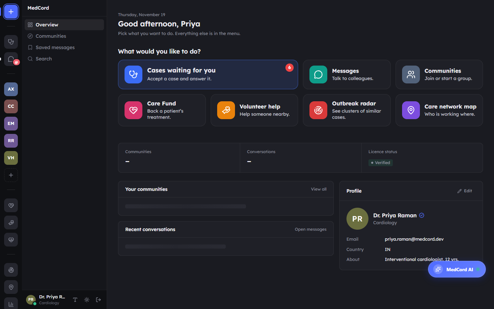 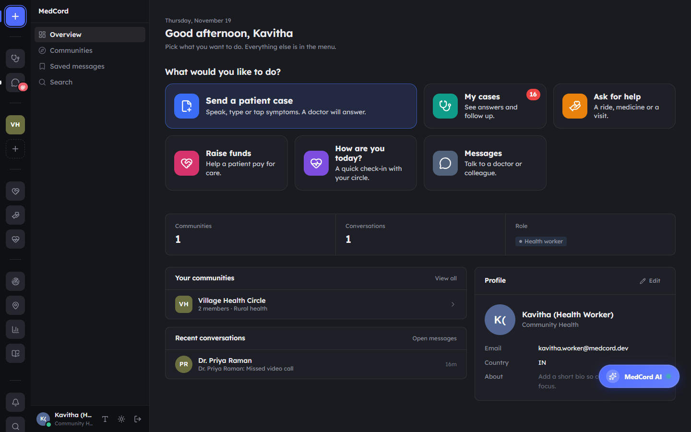

*Home is one screen of plain-language tasks, different for a doctor (left) and a health worker (right).*

</div>

---

## Built on Nexconn


MedCord uses the **Nexconn Chat SDK** for real-time conversation in case rooms, and the **Nexconn Call SDK** for voice and video calls.

<table>
<tr><td width="33%"><b>Real-time case chat</b><br><br>When a health worker sends a message, the doctor's screen updates the moment Nexconn delivers the signal. Both sides show <code>● Live with Nexconn</code>.</td>
<td width="33%"><b>One shared connection</b><br><br>Chat and calls share a single <code>NCEngine</code> connection, started once per sign-in with a server-issued token. The backend keeps the message record.</td>
<td width="33%"><b>Voice and video calls</b><br><br>One-to-one calls in private messages (tested on the deployed app). Once a doctor accepts a case, <i>Voice call</i> and <i>Video call</i> also appear in the case room.</td></tr>
</table>

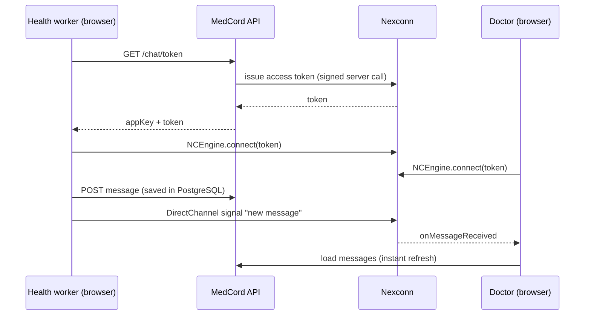

> **Design choice:** PostgreSQL stays the source of truth (history, edits, search, audit). Nexconn carries the instant "new message" signal, so chat still works if Nexconn is unreachable: it falls back to a slow refresh and shows *Updating every few seconds*.

---

## Features

<div align="center">

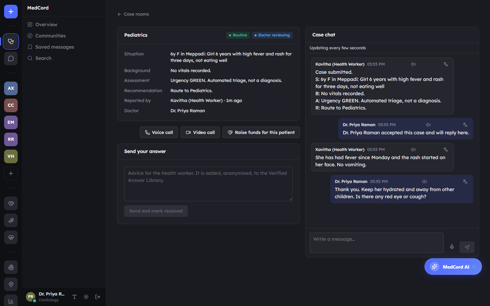

*A case room: automatic SBAR summary, red-flag banner, live chat with voice, translate and read-aloud, and call buttons.*

</div>

### Patient care
- **Voice-first case form** with symptom tiles, vitals and offline queue (sends when signal returns).
- **Automatic triage:** SBAR summary, urgency (red / amber / green), red-flag rules, speciality routing, escalation if nobody accepts.
- **Doctor queue** with *go on duty*, accept, answer, and a 24-hour follow-up with the health worker.
- **Verified answer library** built from doctors' answers (anonymised).
- **Doctor verification:** admin reviews licences before a doctor can answer.

### Languages and accessibility
- **Indian-language voice typing, translation and read-aloud** (Tamil, Hindi, Malayalam, Telugu, Kannada, Bengali, English) with **Sarvam AI**. The API key stays on the server.
- **Large-text mode** (normal, large, extra large) remembered per device.
- **Phone-first layout** with a labelled bottom bar and a full menu sheet; large tap targets; skip link and clear focus outlines.
- Microphone on every form: help requests, check-ins, fundraisers, chat.

### Community
- **Communities for any kind of group** (human health, veterinary, humanitarian): channels, roles, invites, moderation, threads, DMs.
- **Care Fund:** a doctor or health worker raises money for a patient inside a community. A health worker's fundraiser waits for a verified doctor to approve it. Members give ₹10 and up, see updates, and the organiser reports how the money was used. A popup in each community shows who still needs help.
- **Volunteer help:** ask for a ride, medicine pick-up or a home visit. A volunteer taps *I can help* and a private room opens.
- **Daily check-in:** a one-tap mood check, shared with your circle, who can send a kind word.

### Health intelligence
- **Outbreak Radar:** rule-based early warning. Three or more similar cases in one area within 72 hours open an alert, with guidance and a real street map.
- **Care network map:** every area, the health workers in it and the doctors on call, on a real map with pins.
- **Impact dashboard:** cases by area, response times, 14-day trend.

<div align="center">

| Care Fund | Outbreak Radar | Care network |
|:--:|:--:|:--:|
| 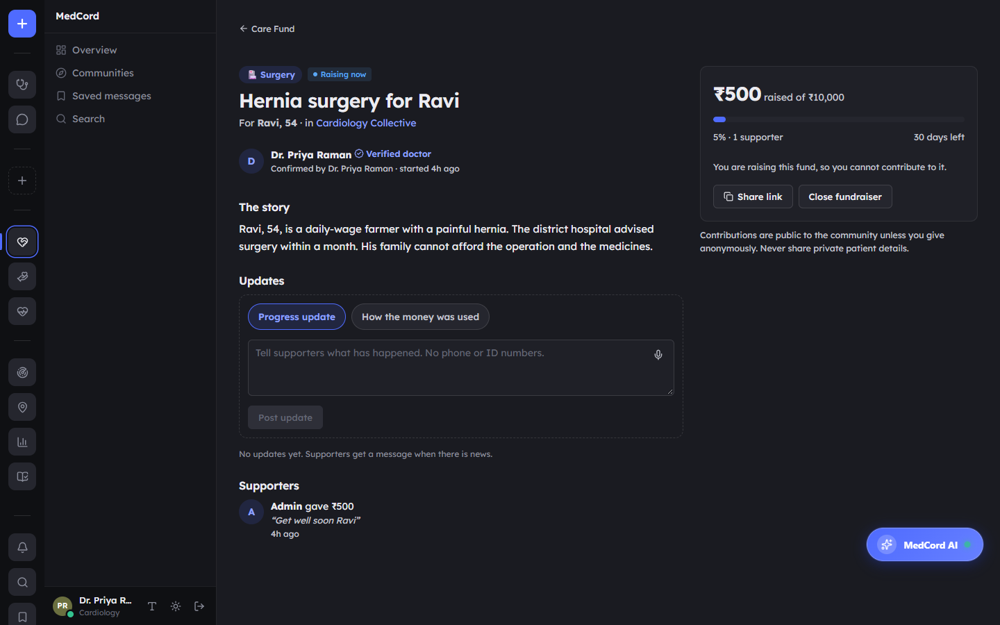 | 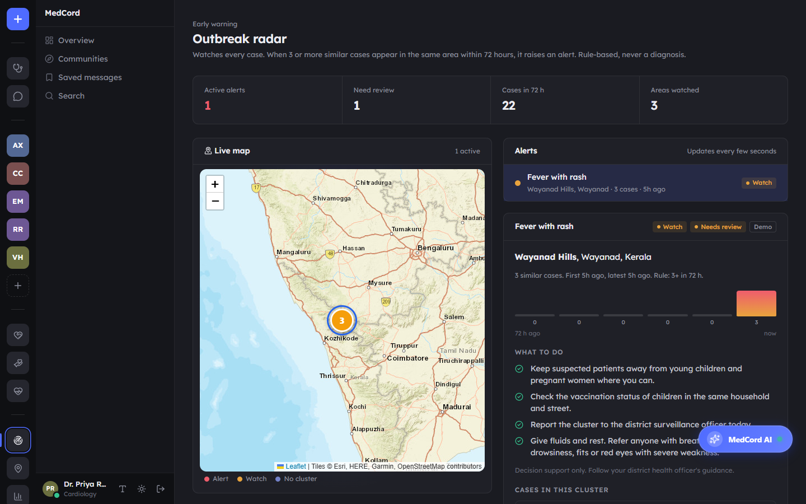 | 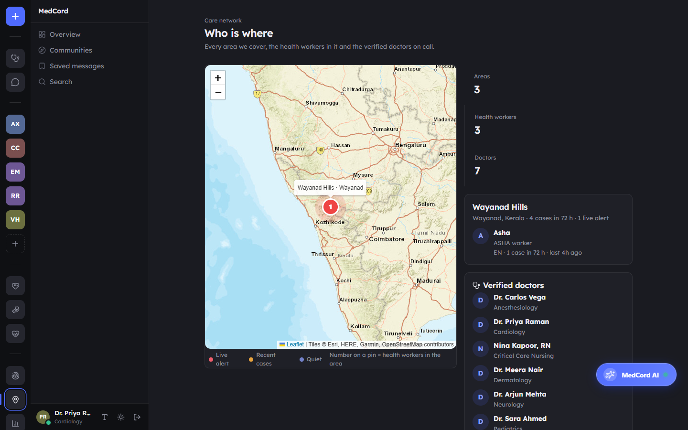 |

| Volunteer help | Daily check-in | On a phone |
|:--:|:--:|:--:|
| 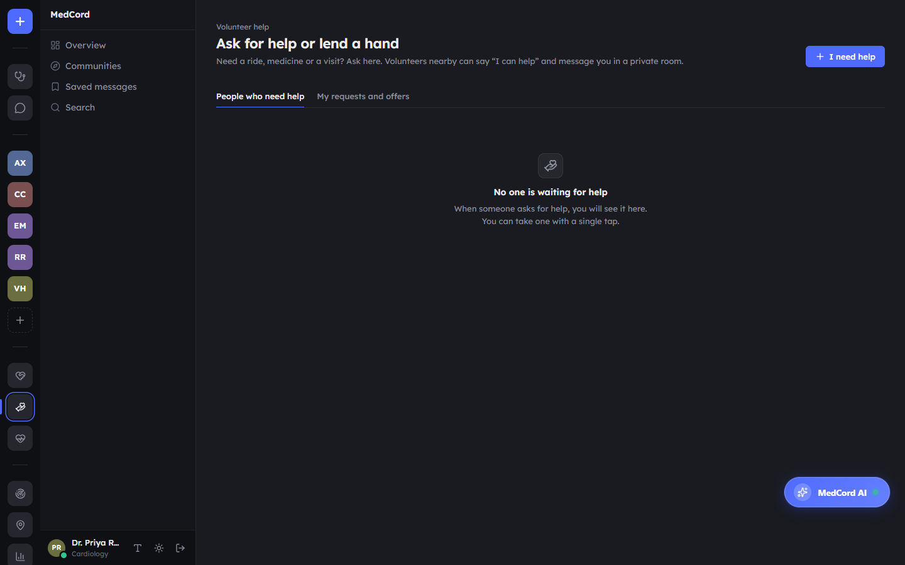 | 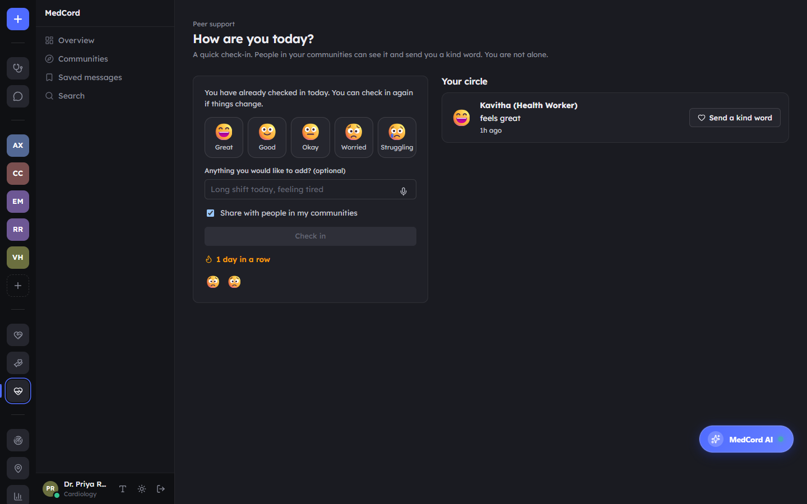 | 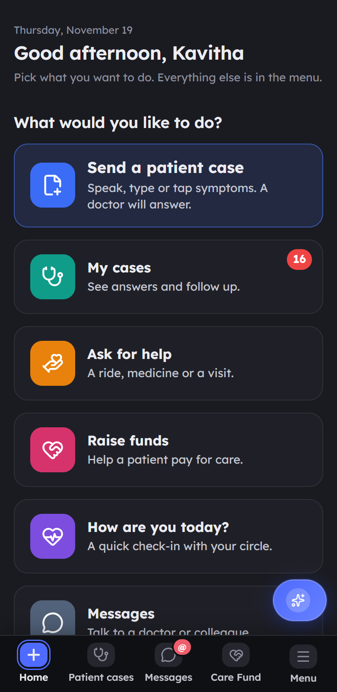 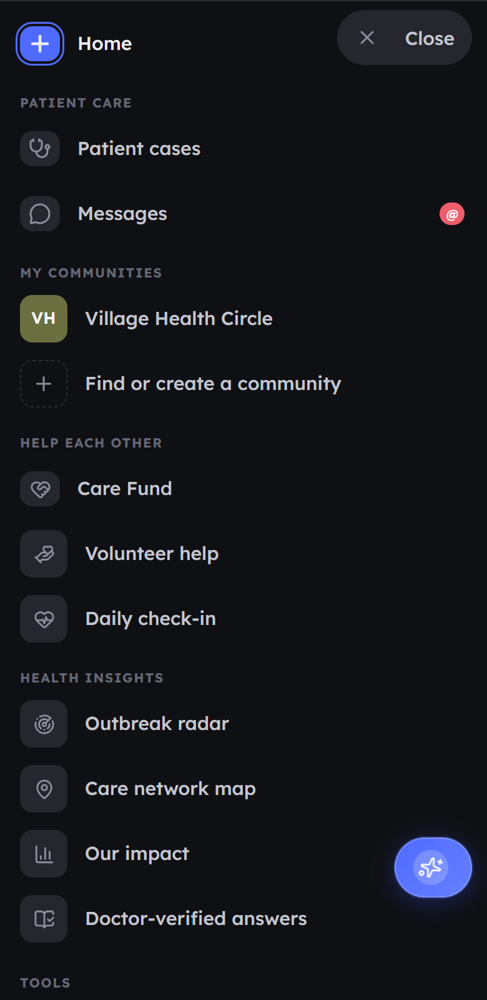 |

</div>

---

## Architecture

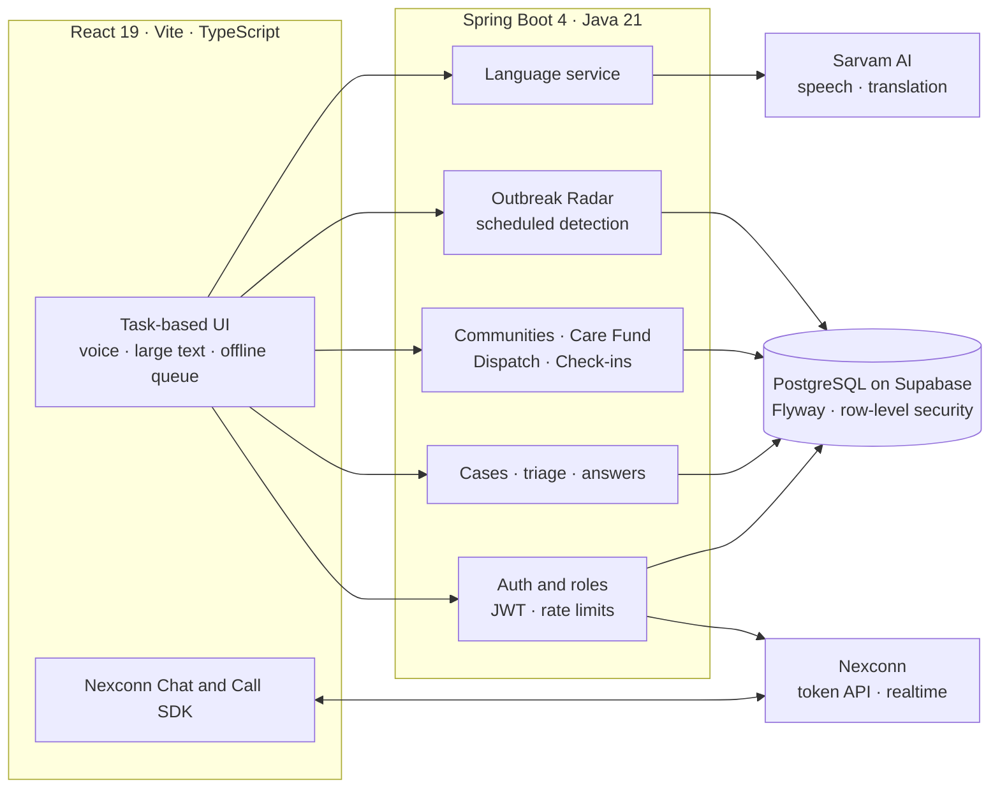

| Layer | Technology |
|---|---|
| Frontend | React 19, Vite 8, TypeScript, React Router, Leaflet (maps), Lucide icons, Vitest and Testing Library |
| Backend | Spring Boot 4, Java 21, JdbcClient and JPA, Flyway, JWT, scheduled jobs, RFC 7807 errors |
| Data | PostgreSQL on Supabase (session pooler), 21 versioned migrations, row-level security on every table |
| Real-time | **Nexconn Chat SDK**, server-sent events as a companion stream |
| Calls | **Nexconn Call SDK** (voice and video) |
| AI | Sarvam AI (speech-to-text, text-to-speech, translation) |
| Maps | Esri street tiles and OpenStreetMap data, with real district coordinates for all of India |

---

## Run it locally

**Prerequisites:** Java 21, Node 24, a PostgreSQL database (a free Supabase project works).

```bash
git clone https://github.com/KarthikeyanMahendran/MedCord.git
cd MedCord
cp .env.example .env          # then fill in the values below (never commit .env)
```

`.env` needs: `DB_HOST`, `DB_PORT`, `DB_NAME`, `DB_USER`, `DB_PASSWORD`, `JWT_SECRET`, `NEXCONN_APP_KEY`, `NEXCONN_APP_SECRET`, `NEXCONN_API_BASE_URL` (for example `https://api.sg-light-api.com`), `VITE_NEXCONN_APP_KEY`, and optionally `SARVAM_AI_API_KEY`.

```bash
# backend (runs Flyway migrations on start)  ->  http://localhost:8080
cd backend && ./mvnw spring-boot:run

# frontend  ->  http://localhost:5173
cd frontend && npm install && npm run dev
```

> Corporate or college networks often block Nexconn. Use a mobile hotspot if the chat shows *Updating every few seconds* instead of *Live with Nexconn*.

### Demo accounts

Try the live app at **https://med-cord.vercel.app/welcome** with these accounts.

| Role | Email | Password |
|---|---|---|
| Health worker | `worker@medcord.com` | `Worker1234` |
| Verified doctor (Cardiology) | `doctor@medcord.com` | `Doctor1234` |
| Admin | `admin@gmail.com` | `Admin1234` |

The sign-in page also shows these three accounts with a one-click **Sign in** button, so anyone can try the app straight away.

Sign-in is email and password only. New people create an account first; doctors choose **Join as a doctor** and give their speciality and licence number.

### Tests

```bash
cd frontend && npm run lint && npx tsc --noEmit && npm test     # 99 tests
cd backend  && ./mvnw test                                       # 119 tests against a real database
```

---

## Privacy, safety and trust

- **No patient-identifiable information.** Free text that looks like a phone or ID number is refused on cases, fundraisers, help requests and check-ins. The app says *demo data only*.
- **Role checks on the server.** Doctors are verified by an admin. A health worker cannot act as a doctor. Fundraisers by health workers need a different doctor's approval.
- **Database locked down.** Row-level security is on every table and public access is revoked. Only the backend reads and writes.
- **Rate limits and refresh-token rotation** on authentication.
- **AI answers respect membership.** The community knowledge assistant only reads communities the user belongs to.
- **API keys stay on the server** and in a gitignored `.env`.

---

## Honest status

| Area | Status |
|---|---|
| Case flow, triage, doctor answers, verified library | Working and tested |
| Real-time case chat on Nexconn | Working (needs network access to Nexconn) |
| Nexconn **voice and video calls** | Working in private messages (tested by two people on the deployed app). The same buttons in the case room are newer and still being verified |
| Care Fund payments | **Simulated.** No real money moves. The live version would add UPI |
| Doctor verification | Admin reviews a licence number in the app. It is not checked against a national register |
| Outbreak detection | Transparent keyword rules, not a diagnosis. Decision support only |

---

## Repository map

| Path | Purpose |
|---|---|
| `backend/` | Spring Boot API, Flyway migrations, Nexconn gateway, tests |
| `frontend/` | React app, Nexconn SDK wiring, voice and language helpers |
| `docs/` | Architecture, runbook, ADRs, use cases, task log, demo script, [submission pack](docs/SUBMISSION.md) |
| `docs/assets/` | Logos used in this README |
| `docs/screenshots/` | App screenshots |

---

## Why this is Humanitarian and Social Good

- **Reach:** it serves people who are hours from a clinic, through the health worker who is already there.
- **Dignity and access:** voice in local languages, large text for seniors, and a phone-first design for people with basic phones and weak signal.
- **Community power:** neighbours fund treatment, volunteers give rides and medicine, and health workers look after each other.
- **Prevention:** the Outbreak Radar warns a district before a cluster becomes an outbreak.
- **Trust:** doctors are verified, answers are reviewed by humans, and patient identity is never shared.

## FAQ

**Is this a diagnosis tool?** No. Triage and the radar are decision support. A verified doctor makes the medical decision.

**Does it work without signal?** A case can be written offline and sends when the signal returns. Live chat needs a connection.

**Do payments move real money?** Not in this demo. Care Fund gifts are simulated.

**Where does Nexconn fit?** Live case chat and voice or video calls. Our database keeps the record of every message, so a bad network never loses a conversation.

---

## Team

**hackCrew**, built for the **Nexconn Build Challenge 2026** (Reskilll), track **Humanitarian and Social Good**.

Built on [MedCord](https://github.com/KarthikeyanMahendran/MedCord) by Karthikeyan Mahendran, with contributions from the hackCrew team.

<div align="center">

<br>

<picture>
  <source media="(prefers-color-scheme: dark)" srcset="docs/assets/nexconn-logo-dark.svg">
  
</picture>

<sub>Real-time communication powered by Nexconn. Nexconn and its logo belong to their owners.</sub>

</div>
